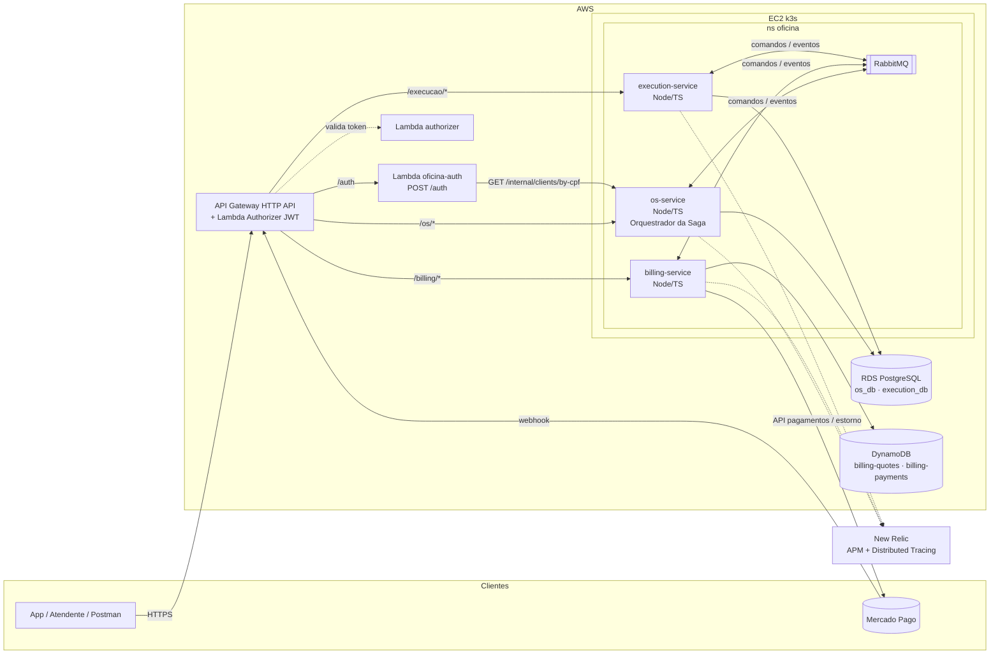
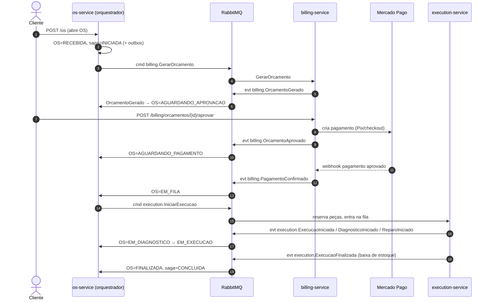
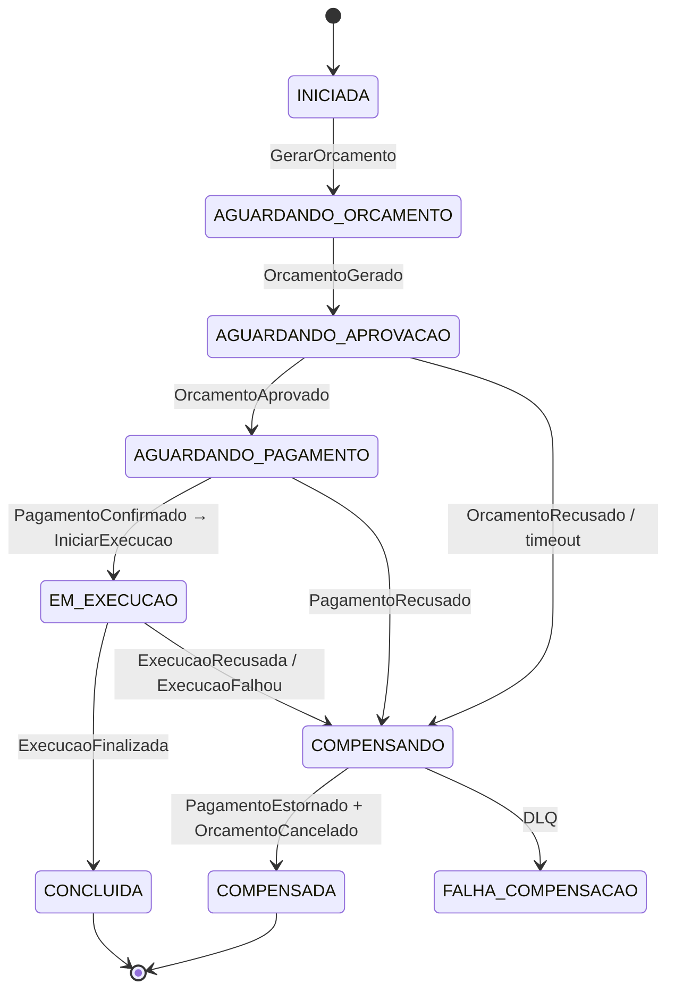

# Arquitetura — Fase 4 (Microsserviços + Saga)

**Autora:** Yara Laurito Duarte (RM373819)
**Status:** Proposta aprovada para implementação

## 1. Visão geral

A aplicação monolítica das fases anteriores é dividida em **3 microsserviços**, cada um com repositório, pipeline, deploy e banco de dados próprios. Todo o tráfego externo entra por um **API Gateway explícito** com **authorizer JWT**, e o fluxo transacional da Ordem de Serviço é coordenado por uma **Saga orquestrada** sobre **RabbitMQ**.

## 2. Divisão dos microsserviços

| Serviço | Repositório | Responsabilidades | Banco | Por que separado |
|---|---|---|---|---|
| **os-service** | `oficinaMarimbondo` (evolução do monolito) | Clientes (com status), veículos, catálogo de serviços e peças, abertura/consulta/histórico da OS, **orquestração da Saga** | PostgreSQL `os_db` | É o dono do ciclo de vida da OS; dados cadastrais são relacionais e consultados com joins |
| **billing-service** | `oficina-billing-service` | Geração de orçamento, aprovação/recusa pelo cliente, pagamento via **Mercado Pago** (Pix/checkout + webhook), **estorno** | **DynamoDB** (NoSQL) | Domínio financeiro com regras e integração externa próprias; documentos de orçamento/pagamento têm esquema variável (payload do MP) e acesso por chave |
| **execution-service** | `oficina-execution-service` | Fila de execução priorizada, diagnóstico, reparo, **reserva/baixa de estoque de peças**, comunicação de finalização | PostgreSQL `execution_db` | Operação da oficina escala de forma independente (picos por filial) e tem consistência local forte no estoque |

Regras:
- **Nenhum serviço acessa o banco de outro.** Integração só por REST (consultas síncronas pontuais) ou mensageria (comandos/eventos).
- A Lambda de autenticação também não lê mais a tabela `clients`: consulta `GET /internal/clients/by-cpf/:cpf` do os-service.
- `os_db` e `execution_db` ficam na mesma instância RDS (custo), mas como **databases e usuários distintos**, cada usuário com permissão apenas no seu database.

## 3. Fluxo da OS e Saga orquestrada

Escolha: **orquestração**, com o orquestrador dentro do os-service (detalhes em [ADR-005](../ADR-005-saga-orquestrada.md)).

### 3.1 Caminho feliz

### 3.2 Falhas e compensações

| Falha | Detectada por | Compensações (em ordem reversa) | Estado final |
|---|---|---|---|
| Orçamento recusado pelo cliente | billing → `OrcamentoRecusado` | — | OS `CANCELADA`, saga `COMPENSADA` |
| Orçamento não respondido em 72h | timeout no orquestrador | `billing.CancelarOrcamento` | OS `CANCELADA` |
| Pagamento recusado/expirado | webhook MP → `PagamentoRecusado` | `billing.CancelarOrcamento` | OS `CANCELADA` |
| **Estoque insuficiente** ao iniciar execução | execution → `ExecucaoRecusada` | `billing.EstornarPagamento` (refund no MP) → `billing.CancelarOrcamento` | OS `CANCELADA` |
| Falha durante o reparo (abortado) | execution → `ExecucaoFalhou` | execution libera peças localmente → `billing.EstornarPagamento` → `billing.CancelarOrcamento` | OS `CANCELADA` |
| Compensação falha repetidamente | DLQ após 5 tentativas | alerta no New Relic; reprocessamento manual da DLQ | saga `FALHA_COMPENSACAO` |

### 3.3 Status da OS (os-service)

`RECEBIDA → AGUARDANDO_APROVACAO → AGUARDANDO_PAGAMENTO → EM_FILA → EM_DIAGNOSTICO → EM_EXECUCAO → FINALIZADA → ENTREGUE`, mais `CANCELADA` (estado terminal de compensação).

## 4. Comunicação

| Tipo | Uso | Tecnologia |
|---|---|---|
| Síncrona | Gateway → serviços; Lambda auth → os-service; consultas pontuais (ex.: billing consulta itens da OS) | REST/JSON |
| Assíncrona | Comandos da Saga e eventos de domínio | RabbitMQ (ver [ADR-006](../ADR-006-mensageria-rabbitmq.md)) |

Contratos das mensagens: [EVENTOS.md](./EVENTOS.md).

Garantias:
- **Outbox transacional** no os-service: estado da saga + mensagem na mesma transação; um relay publica no RabbitMQ.
- **Consumidores idempotentes**: cada serviço registra o `messageId` processado (tabela `processed_messages` / item condicional no DynamoDB).
- **Retry com backoff** (3 tentativas) e **DLQ** por fila.

## 5. Segurança e borda

Detalhes em [ADR-008](../ADR-008-api-gateway.md).

- **API Gateway HTTP API declarado em Terraform**, com um Lambda authorizer que valida a assinatura, o `iss`, o `aud` e a expiração do JWT.
- Rotas públicas: `POST /auth` e `POST /billing/webhooks/mercadopago`, que é validada pela assinatura `x-signature` do Mercado Pago.
- **k3s sem acesso público direto**: o Security Group só aceita tráfego no Ingress, e o Ingress exige um header secreto injetado pelo Gateway.
- Rotas `/internal/*` não são publicadas no Gateway e exigem `x-internal-api-key`.

## 6. CI/CD e ambientes

- Um pipeline por repositório: build → testes (com cobertura mínima de 80%) → SonarCloud (quality gate) → imagem Docker → deploy no k3s.
- Branches: `feature/*` → PR → `homolog`, que faz deploy no namespace de homologação → PR → `main`, que faz deploy em produção.
- `main` e `homolog` protegidas: PR obrigatório, checks obrigatórios e sem push direto.

## 7. Observabilidade

- Agente **New Relic** em todos os serviços, com distributed tracing ativo.
- Propagação do contexto de trace (`traceparent` / `newrelic`) nos headers das mensagens RabbitMQ: um único trace cobre gateway → os-service → billing → execution.
- `sagaId` e `osId` em todos os logs estruturados, além de um dashboard com OS por status, sagas compensadas, tamanho das filas e DLQ.
